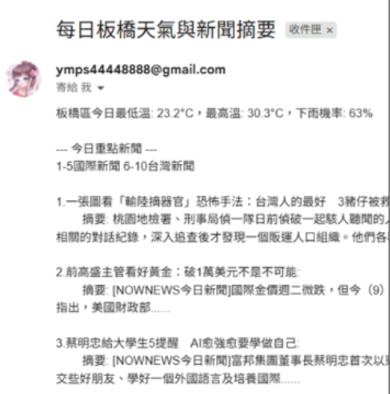

**InfoBot：每日氣象與新聞推播系統**

**動機與實作方式：**
每日需分別開啟天氣 App 與新聞網站查詢資訊，過程繁瑣，遂以 Python 開發自動化資訊整合與推播系統：透過 requests 套件向氣象 API 發送請求，擷取指定地區之即時氣溫與降雨機率；並以 NewsAPI 進行關鍵字檢索，擷取國內外重要新聞標題。整合後之資料以 Python 電子郵件套件封裝，發送至指定信箱。 

**執行成果：**

信件範例 ：

